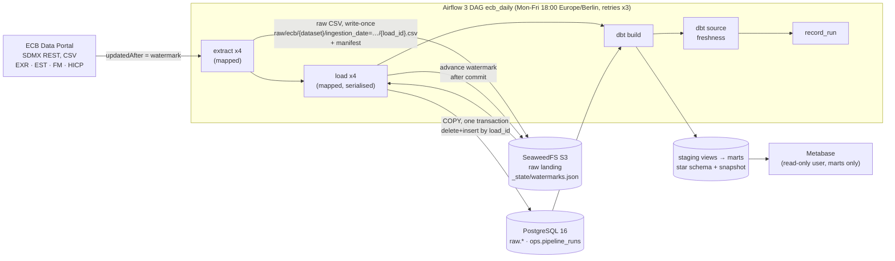
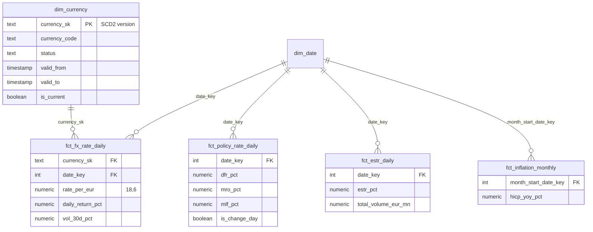
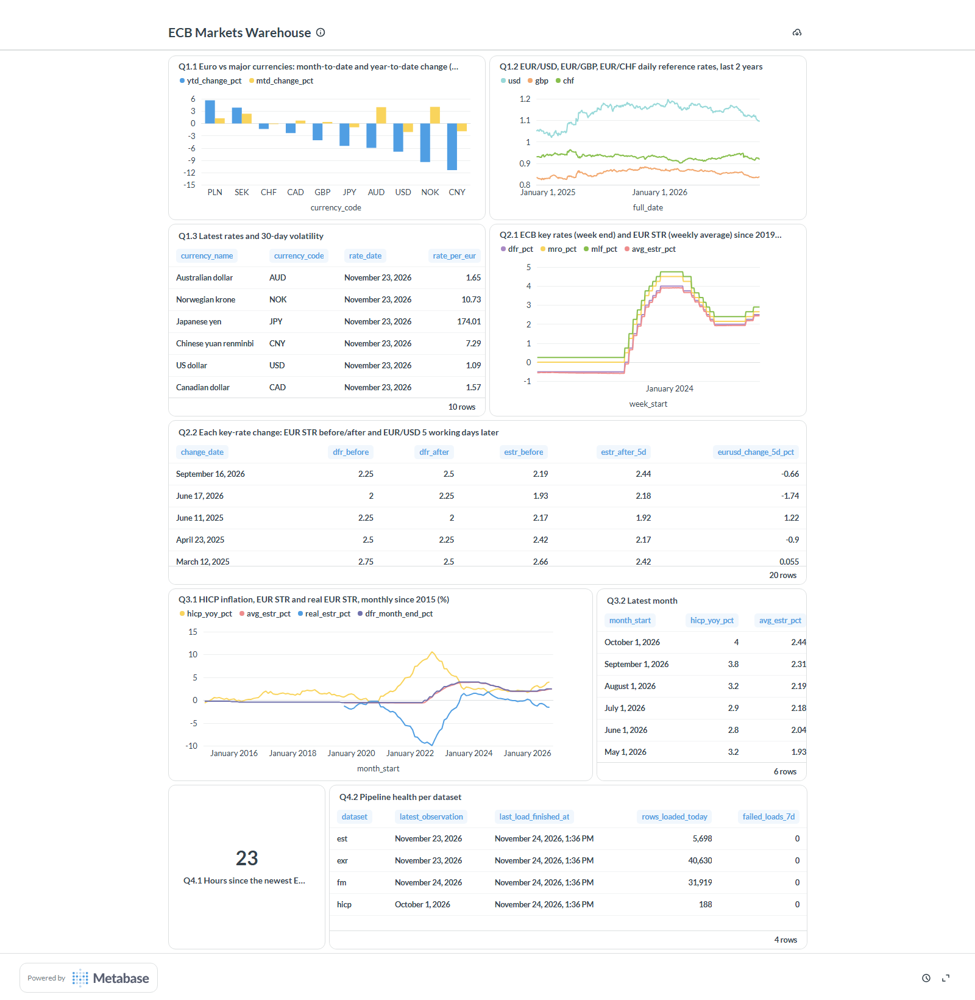

# ECB Markets Warehouse

[](https://github.com/leithjendoubi/ecb-markets-warehouse/actions/workflows/ci.yml)

**One trusted daily view of euro exchange rates, ECB policy rates, the euro short-term rate (€STR) and euro-area
inflation**, the numbers a treasury or FX-risk team checks every morning. Official ECB statistics are pulled
**incrementally**, landed **unchanged** in S3-compatible storage, loaded **idempotently** into PostgreSQL and
modelled with **dbt** into a **tested Kimball star schema**, orchestrated by **Apache Airflow 3** and served in
**Metabase**. Everything runs locally with Docker Compose.

| # | Business question | Answered by |
|---|---|---|
| Q1 | How have major currencies moved vs the euro (daily, MTD, YTD), and how volatile are they? | `fct_fx_rate_daily`, `mart_fx_performance` |
| Q2 | How do ECB policy-rate decisions line up with €STR and FX moves? | `fct_policy_rate_daily`, `fct_estr_daily` |
| Q3 | What is euro-area inflation doing; what is the real (inflation-adjusted) €STR? | `mart_rates_monthly` |
| Q4 | Is today's data complete and fresh? | dbt source freshness, gap tests, `ops.pipeline_runs` → `mart_pipeline_health` |

Full specification: [docs/spec.md](docs/spec.md) · progress log: [docs/PROGRESS.md](docs/PROGRESS.md) ·
operations: [docs/runbook.md](docs/runbook.md)

## Architecture



| Component | Responsibility | Key choice |
|---|---|---|
| Extractor (`ingestion/ecb_ingest`) | call the API per dataset, land the raw file, write a manifest | config-driven; httpx + tenacity retries; whole-second `updatedAfter` |
| SeaweedFS (S3 API :8333) | immutable raw landing zone + watermark state | write-once objects; boto3 |
| Loader | COPY into `raw.*` with `load_id`, `extracted_at`, `ingested_at`, `source_url` | delete-then-insert by `load_id` in one transaction; run log in `ops.pipeline_runs` |
| dbt Core 1.12 | staging → intermediate → marts, snapshot, tests, docs | incremental facts with 7-day look-back |
| Airflow 3.4 (LocalExecutor) | schedule, retries, backfill | dynamic task mapping per dataset; pipeline code in its own venv |
| Metabase | dashboard | dashboard defined as code in [docs/dashboard.md](docs/dashboard.md) |

## Quick start

Prerequisites: Docker Desktop (or Docker Engine + Compose v2) and GNU make
(Windows: `scoop install make`). Then, from a fresh clone:

```bash
cp .env.example .env     # local-only defaults; change the passwords if the machine is shared
make up                  # build + start Postgres, SeaweedFS, Airflow, Metabase; waits until all are healthy
make demo                # first DAG run (loads full history) + creates the Metabase dashboard
```

Then open **Metabase** at http://localhost:3000 (login `METABASE_ADMIN_EMAIL` / `METABASE_ADMIN_PASSWORD` from
`.env`) → dashboard "ECB Markets Warehouse", and **Airflow** at http://localhost:8080 (`AIRFLOW_ADMIN_USER` /
`AIRFLOW_ADMIN_PASSWORD`). The DAG is now unpaused and runs Mon-Fri at 18:00 Europe/Berlin.

Other commands: `make backfill START=2024-01-01 END=2024-12-31` · `make dbt-build` · `make psql` ·
`make checksum` · `make benchmark` · `make logs` · `make down` (keep data) · `make clean` (delete volumes).
For development (tests, lint) on the host: `make venv` then `make test` / `make lint` / `make test-integration`.

## Data sources (ECB Data Portal, free, no API key)

| Dataset | Series key | Frequency | Loaded history (first full load, `ops.pipeline_runs`) |
|---|---|---|---|
| EXR exchange rates | `EXR/D.USD+GBP+CHF+JPY+CNY+SEK+NOK+PLN+CAD+AUD.EUR.SP00.A` | ECB working days | 30,450 rows, 2015-01-02 → |
| EST €STR | `EST/B.EU000A2X2A25.WT+TT` (rate, volume) | TARGET days | 3,662 rows, 2019-10-01 → |
| FM key ECB rates | `FM/D.U2.EUR.4F.KR.DFR+MRR_FR+MLFR.LEV` | every calendar day | 27,539 rows, 1999-01-01 → |
| HICP inflation | `HICP/M.U2.N.000000.4D0.ANR` | monthly | 142 rows, 2015-01 → |

Real responses for every dataset (and the API's "no data" and "bad request" answers) are saved in
[tests/fixtures/](tests/fixtures) and are the only thing the parser and the unit tests are built on.

## Data model (Kimball star schema, schema `marts`)



| Table | Grain | Load |
|---|---|---|
| `dim_date` | calendar day 1999-2030 | full rebuild; weekend, TARGET holiday/business day, ECB working day flags |
| `dim_currency` | currency × version | dbt snapshot (check strategy) of seed `currency_reference.csv` → SCD Type 2 |
| `fct_fx_rate_daily` | currency × ECB working day | incremental delete+insert, 7-day look-back |
| `fct_policy_rate_daily` | calendar day | incremental; DFR/MRO/MLF forward-filled (max 7 days) on a date spine |
| `fct_estr_daily` | TARGET day | incremental |
| `fct_inflation_monthly` | month | incremental, 12-month look-back |
| `mart_rates_monthly` | month | avg €STR, month-end DFR/MRO/MLF, HICP YoY, real €STR = €STR − HICP |
| `mart_fx_performance` | currency × month | MTD / YTD change, 30-day volatility |
| `mart_pipeline_health` | dataset × run day | loads, rows, failures, newest observation (Q4) |

Layers: `raw` (text, every load kept) → `staging` views (typed, latest version per `(series_key, time_period)`)
→ `intermediate` pivots → `marts`. FX rates are foreign currency per 1 EUR and **non-additive**: they are
averaged or compared, never summed. Every model and column is documented (`make docs-check`).

## Dashboard



Nine native-SQL cards, all on `marts`, defined in [docs/dashboard.md](docs/dashboard.md) and created by
`make dashboard` through the Metabase API (screenshot: `make dashboard-screenshot`).

## Design decisions

| ADR | Decision |
|---|---|
| [0001](docs/decisions/0001-pipeline-venv-in-airflow-image.md) | Pipeline code + dbt in their own venv inside the Airflow image |
| [0002](docs/decisions/0002-load-ids-and-watermarks.md) | Unique load ids for incremental loads, deterministic ids for backfills, watermark advanced after commit |
| [0003](docs/decisions/0003-empty-responses.md) | "No data" is an HTTP 404; normal when incremental, an error on a first full load |
| [0004](docs/decisions/0004-calendar-and-working-days.md) | TARGET calendar computed, ECB working days observed, both cross-checked |
| [0005](docs/decisions/0005-freshness-anchor.md) | EXR freshness measured from the 16:00 CET publication time |
| [0006](docs/decisions/0006-scd2-currency-dimension.md) | SCD2 currency dimension from a seed snapshot, first version back-dated |
| [0007](docs/decisions/0007-policy-rate-forward-fill.md) | Bounded forward fill; MRO stays NULL during the 2000-2008 variable-rate tenders |
| [0008](docs/decisions/0008-incremental-facts.md) | Incremental facts read a window buffer so they equal a full refresh |

## Data quality

| Layer | Check | Severity |
|---|---|---|
| Source | EXR freshness: warn 24 h, error 72 h after publication | warn / error |
| Staging | `(series_key, time_period)` unique + not null; rate > 0; currency in accepted list | error |
| Dim | exactly one `is_current` row per currency; SCD2 versions contiguous | error |
| Dim | EXR rates only on computed TARGET business days | error |
| Fact | foreign keys resolve; grain unique; policy spine has no gaps | error |
| Fact | no missing ECB working day for active currencies | warn |
| Fact | `abs(daily_return_pct) < 10` | warn |
| Pipeline | rows loaded > 0 on working days (runs after publication) | error |

`dbt build` on the full history: **PASS=114, WARN=1, ERROR=0** (115 nodes). The one warning is real: CHF on
2015-01-15 moved −14.40 % when the Swiss National Bank removed the EUR/CHF floor.
Python: 52 offline unit tests (fixtures, mock HTTP transport, in-memory S3), 6 integration tests (Postgres;
loader idempotency, rollback, SCD2), 5 Airflow DAG structure tests. Unit tests never call the live API.

## Idempotency proof

All numbers below were produced on 2026-11-24 by the scripts named (details in [docs/PROGRESS.md](docs/PROGRESS.md)).

- **Re-running a day**: raw row counts + checksums (`scripts/raw_counts.sql`) identical after re-running the DAG;
  incremental loads find nothing new (`updatedAfter`) and log `no_data`.
- **Re-running a backfill**: `make backfill START=2024-11-25 END=2026-11-24` twice → identical raw counts and
  checksums (exr 5,090 / est 1,018 / fm 2,190 / hicp 23 rows each time; deterministic backfill `load_id`).
- **Full refresh = incremental**: `scripts/checksum.sql` (the spec query) and `scripts/fact_checksums.sql` give
  identical results after an incremental run, after deleting the last 20 days and running incrementally, and
  after `dbt build --full-refresh`: `fct_fx_rate_daily` n = 30,450, md5 `f025dcf3c13a34e30c3201007da042f8`.
  CI repeats this check on every push.

## Run time

`make benchmark` (`scripts/benchmark.sql` on `ops.pipeline_runs`): median **27.9 s** (min 26.0 s, max 35.0 s)
over the 5 most recent incremental DAG runs, from DAG start to the end of source freshness. Measured on
2026-11-24 14:11–14:14 UTC on a Windows 11 laptop (Docker Desktop); these were manually triggered runs on one
day that found no new observations, so they measure the fixed cost of a daily run (API checks, loads, `dbt build`
of 115 nodes, freshness), not scheduled 18:00 runs.

## What I would change in production

- Managed services: S3 + object lock instead of SeaweedFS, managed Postgres, Airflow on Kubernetes/MWAA with a
  Celery or K8s executor, secrets from a vault instead of `.env`.
- Watermarks in a transactional store (or S3 conditional writes) so loads can run in parallel.
- Alerting: Airflow failure callbacks / freshness errors to Slack or PagerDuty; dbt test results to a log table.
- Separate dev / CI / prod targets and schemas; dbt `state:modified` slim CI; a blue/green swap for marts.
- Add the ECB minimum bid rate series to fill the 2000-2008 MRO gap (ADR 0007); cross rates; more currencies.
- Data contracts on the raw columns (today a missing required column fails the load, optional ones become NULL).

## Limitations

- ECB revisions older than the 7-day look-back (12 months for HICP) need `dbt build --full-refresh`.
- MRO (fixed rate) is NULL 2000-07-05 → 2008-10-14: the ECB ran variable-rate tenders and that series has no data.
- The watermark uses the pipeline host's clock; large clock skew could skip an update (staging de-duplication
  makes the opposite, a double fetch, harmless).
- SCD2 versions are only as granular as snapshot runs; the first version is back-dated to 1999-01-01.
- `vol_30d_pct` is the daily standard deviation of returns (not annualised).
- Metabase questions show at most 2,000 rows, so the long daily policy-rate chart is weekly.
- Local-only security: the read-only Metabase user can only read `marts`, but credentials live in `.env`.

## Repository layout

```
ingestion/ecb_ingest/   client.py extract.py load.py state.py parsing.py config.yaml cli.py
airflow/                Dockerfile, dags/ecb_daily.py
dbt/ecb_warehouse/      models/{staging,intermediate,marts} snapshots/ seeds/ tests/ macros/
sql/init/               roles, databases, schemas raw/ops (+ raw tables, run log)
scripts/                checksum.sql, fact_checksums.sql, benchmark.sql, metabase_setup.py, ci/
tests/                  unit/ integration/ dags/ fixtures/ (real ECB responses)
docs/                   spec.md PROGRESS.md runbook.md dashboard.md decisions/ img/
```
